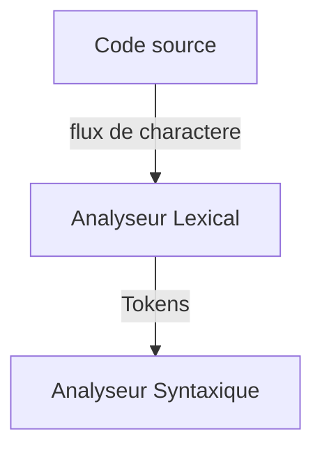

Objectif : apprendre les different concept d'un compilateur ici on se restreint a:

- à certain contruction des language de programation

- à certain etape de'un compilateur
  
  - analyse lexicale
  
  - analyse syntaxique
  
  - analyse sementique
  
  - generation de code 

compilateur = traducteur d'un language $L$ vers un language $L'$ 

**Pratique :**

Un language en entre du compilateur est $L$ : language concu par l'etudiant avec en entree des contruction demandées 

Language cilce $L'$ = language d'une machine virtuelle apelle Machine Virtuelle a Programer.

Outil de generation du compilateur = ANTRL, les language d'ecriture seront : java, ANTRL.

La syntaxe du language de programation à concevoir sera decrite avec une grammaire hors-contexe. Certaines contruction sont ambigue, on va voir des heuritiques pour les rentre non-ambigues

# Analyse lexicale

Un **token** est un ensemble de'information qui caracterise un objet terminale de la grammaire hors contexte decrivant le language.

Un **lexeme** = suite de charactere.

une **unite lexicale** = un ensemble de lexèmes.

**Exemples :** $ E \to E+E|E*E|nb$

code source : nb + nb + nb \* nb \* nb + nb

On a 11 lexeme : 

- 6 ocurence de nb

- 3 occurence de +

- 2 occurence de \*

On a 2 unite lexicale :

- un correspond au lexeme nb

- un correspond au lexeme + et \* 

$F \to F*F|F+F|I; \ \ I\to 0I|1I|\epsilon$

ex: 0+1*01+110+111

#arbre de derivation

un **Token** est compose de :

- unite lexical T

- lexeme de T

- d'autre inforamation pour aider :
  
  - numero de ligne, numero de colone
  
  - valeur entiere pour un lexeme 
  
  -  representer un entier

Un analyseur lexical va produire un flux de token pour l'anaylseur syntaxique 

Comment faire:

- chaque unite lexicale du language est decrite par une expression reguliere

- un analyseur lexical = union des automates à etat finis associe aux unite lexicale + des action permettant de calculer les jetons de $n$-ème reconnus

## Cas de l'intersection des unite lexicales

solution facile :

- ordonner les regle des unite lexicales 

-  lorsqu' un lexeme appartient a plusieur unite lexicale, choisir la plus petite.

ANTLR :

l'ordre choisi par ANTLR = l'ordre d'ecriture de regle.

Ex: BEGIN : 'begin'; ID:[a-z]+

2 unite lexicales: BEGINet ID le lexere "begin" sera considere comme lexeme de BEGIN 

## Cas lexeme prefixe d'un autre

- Greedy:on lit le lexeme le plus long possible. (solution par default de ANTLR)

- Non-Greedy: prendre le lexeme le plus petit .(des qu' une suite de caractere est accepte, on arrete la lecture)

---

L'analyseur lexical doit resoudre 2 probleme :

- l'intersection de 2 unite lexicales. Laquelle choisir

---

EX : beginner avec la methode gloutone sera reconnue comme un lexeme de ID.  
avecc la methode non-gloutone, on pourrait avoir 2 lexeme "begin" et "non".

EX2 : STRING : ' " ' \* ' " ' ; "m1""m2".  

- glouton 1 seule lexeme "m1""m2"  

- non gloutone : 2 lexeme "m1" et "m2"

