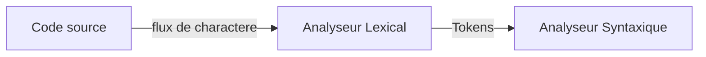
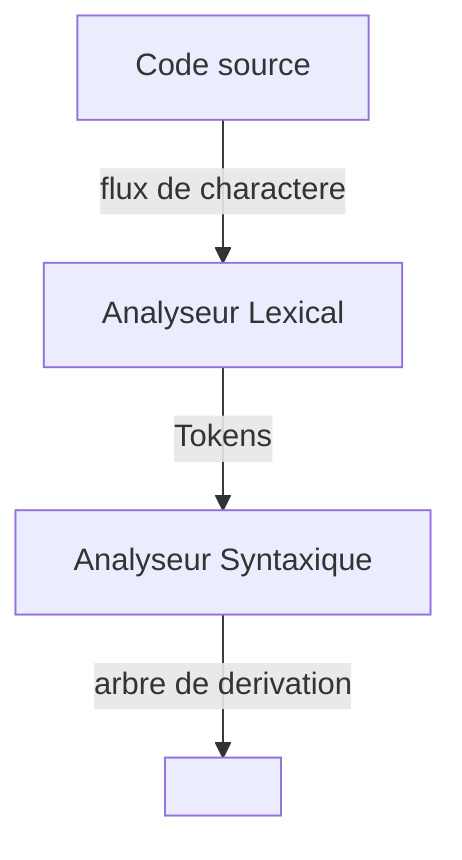
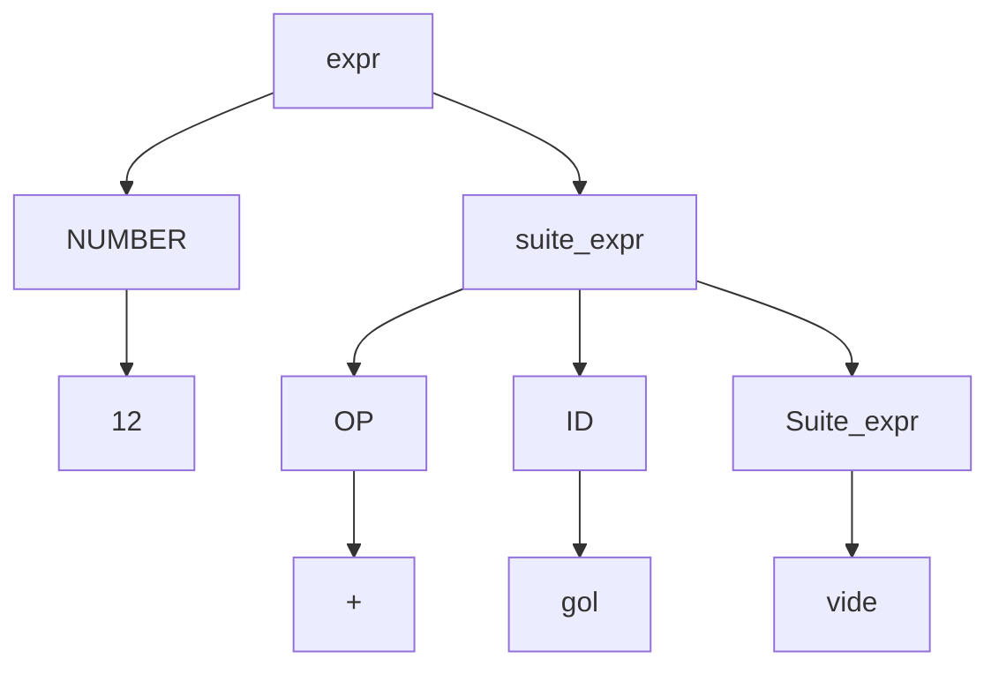
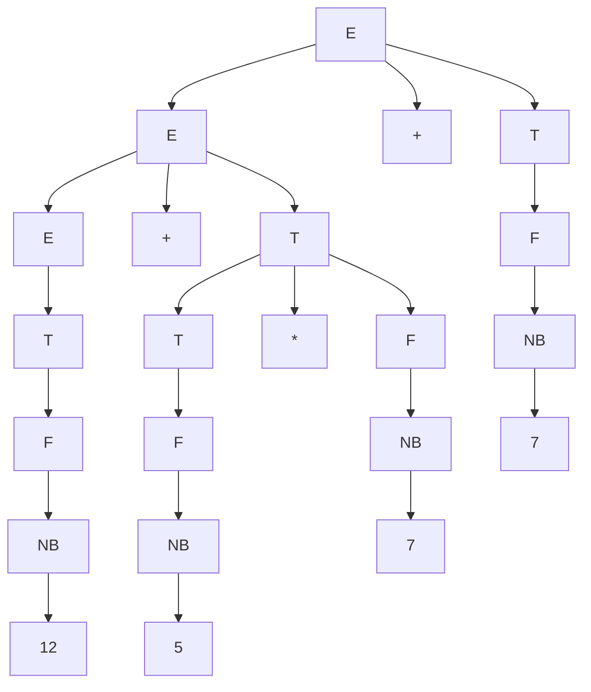

Objectif : apprendre les different concept d'un compilateur ici on se restreint a:

- à certain contruction des language de programation

- à certain etape de'un compilateur

  - analyse lexicale

  - analyse syntaxique

  - analyse sementique

  - generation de code

compilateur = traducteur d'un language $L$ vers un language $L'$ 

**Pratique :**

Un language en entre du compilateur est $L$ : language concu par l'etudiant avec en entree des contruction demandées 

Language cilce $L'$ = language d'une machine virtuelle apelle Machine Virtuelle a Programer.

Outil de generation du compilateur = ANTRL, les language d'ecriture seront : java, ANTRL.

La syntaxe du language de programation à concevoir sera decrite avec une grammaire hors-contexe. Certaines contruction sont ambigue, on va voir des heuritiques pour les rentre non-ambigues

# Analyse lexicale

Un **token** est un ensemble de'information qui caracterise un objet terminale de la grammaire hors contexte decrivant le language.

Un **lexeme** = suite de charactere.

une **unite lexicale** = un ensemble de lexèmes.

**Exemples :** $ E \to E+E|E*E|nb$

code source : nb + nb + nb \* nb \* nb + nb

On a 11 lexeme : 

- 6 ocurence de nb

- 3 occurence de +

- 2 occurence de \*

On a 2 unite lexicale :

- un correspond au lexeme nb

- un correspond au lexeme + et \*

$F \to F*F|F+F|I; \ \ I\to 0I|1I|\epsilon$

ex: 0+1*01+110+111

#arbre de derivation

un **Token** est compose de :

- unite lexical T

- lexeme de T

- d'autre inforamation pour aider :

  - numero de ligne, numero de colone

  - valeur entiere pour un lexeme 

  - representer un entier

Un analyseur lexical va produire un flux de token pour l'anaylseur syntaxique 

Comment faire:

- chaque unite lexicale du language est decrite par une expression reguliere

- un analyseur lexical = union des automates à etat finis associe aux unite lexicale + des action permettant de calculer les jetons de $n$-ème reconnus

## Cas de l'intersection des unite lexicales

solution facile :

- ordonner les regle des unite lexicales 

- lorsqu' un lexeme appartient a plusieur unite lexicale, choisir la plus petite.

ANTLR :

l'ordre choisi par ANTLR = l'ordre d'ecriture de regle.

Ex: BEGIN : 'begin'; ID:[a-z]+

2 unite lexicales: BEGINet ID le lexere "begin" sera considere comme lexeme de BEGIN 

## Cas lexeme prefixe d'un autre

- Greedy:on lit le lexeme le plus long possible. (solution par default de ANTLR)

- Non-Greedy: prendre le lexeme le plus petit .(des qu' une suite de caractere est accepte, on arrete la lecture)

---

L'analyseur lexical doit resoudre 2 probleme :

- l'intersection de 2 unite lexicales. Laquelle choisir

---

EX : beginner avec la methode gloutone sera reconnue comme un lexeme de ID.  
avecc la methode non-gloutone, on pourrait avoir 2 lexeme "begin" et "non".

EX2 : STRING : ' " ' \* ' " ' ; "m1""m2".  

- glouton 1 seule lexeme "m1""m2"  

- non gloutone : 2 lexeme "m1" et "m2"

EX3: 

STRING : ' ".\*" ' mot "w1""w2" lexele associe "w1""w2"

Si on veux le mode non glouton  STRING :' ".\*?" ' les lexeme sont "w1" et "w2"

EX4: Si on veux des guillemet comme caractere : STRING ' "(ESC|.)\*" '

ESC : ' \\\" ' | ' \\\\ \\\ ' 

ex: "w1\\\"w2" le lexeme sera "w1"w2"

# Analyse syntaxique

La syntaxe d'un language de programation est decrite avec une grammaire hors contexte.  
On demande à l'analyseur syntaxique de calculer quelques valuer, pour chaque noeud de l'arbre de derivarion, ces valeur sont appelées attribut. C'est l'annotation de la gramaire hors contexte qui permet de calculer ces valeur on parlera de grammaire annotée.

ex : anote une parentrese avec un numero pour dire si elle en a une fermermante.

Ce sera ANTLR qui generera l'analyseur lexical et syntaxique. Il suffit de lui donner la grammaire (anote ou non) et les unités lexicales. Les unite lexicales sont données en fin de fichier et leur nom en MAJUSCULE.

Exemple dnas ANTLR:

**grammar** Ex_parser; // Ex_parser=som du compilateur.

//regle de l'analyseur syntaxique

expr:(NUMBER | ID) suite_expr;

suite_expr : OP(NUMBER | ID ) suite_expr | ;

// regle de l'analyseur lexical

NUMBER : ('0' ... '9')+ ;

ID : ('a' ... 'z')+;

OP: '+' | '\*' | '/' | '-';

---

Ex: 12 + gol

on a 3 lexeme :

- 12

- + 

- gol

Liste des lexemes :

- **[@0,0:1='12',<1>,1:0] :**

  - @0  numero du token

  - 0:1 intervalle de caracte du lexeme

  - '12' valuer du lexeme

  - <1> numero de l'unite lexicale

  - 1:0 numero de ligne , numero de colone

- [@1,2:2='+',<3>,1:2] 

- [@3,3:5='gol',<2>,1:3]

Arbre de derivation:

---

En cours de grammaire vous avez l'equivalence entre une grammaire hors contexte et automate à pile. La contruction est polynomiale en la taille dela grammaire. Mais l'automate est non-deterministe et donc on a par default un algorithme en temps $d(G)^n$ pour $n$ la taille du mot en entree et $d(G)$ la taille maxiamle de'une regle.

**Theoreme :** 

Il exite un algorithme $\mathcal{A}$ tq :

- entrée : 

  - une grammaire hors contexte $G$.

  - un mot de $u$

- suite : $(u \in L(G) et 1 arbre de derivation ou u \notin L(G))$

$\mathcal{A}$ s'execute en temps $f(|G|). |u|³$

Cet algorithme si $G$ etait "deterministe" on aurait un algorithme linéaire.  
Mais pas le cas de toutes les grammaires.

Solution : heuristique pour calculer en temps lineaire un arbre de derivation.

2 familles :

- LL(k) derivation gauche et on lit k caractere et on n'a plus le choix de la regle. (defaut ANTLR)

- LR(k)

# Grammaire Attribuées (ou annotées)

**Definition :** Une grammaire attribuées est un grammaire hors contexte ou on associe à chaque non-terminal des etiquettes, appelée attributs.  
L'annotation de la grammaire consistera à donner les regles de calcul des valuer des attributs.

Les règles de calcul permettront d'associer à chaque occurence de la variable et donc chaque noeud de l'arbre de derivation associe a cette variable, les valeur des attribut de la variable.

Ex:

$$
E \to E +T |T \\
T \to T*F|F\\
F\to (E)|NB\\
NB\to (0...9)+
$$

ex: 12+5*7+7

