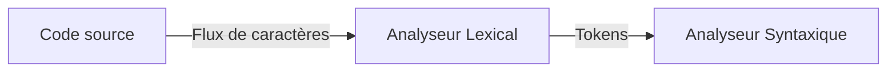
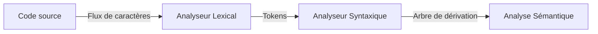
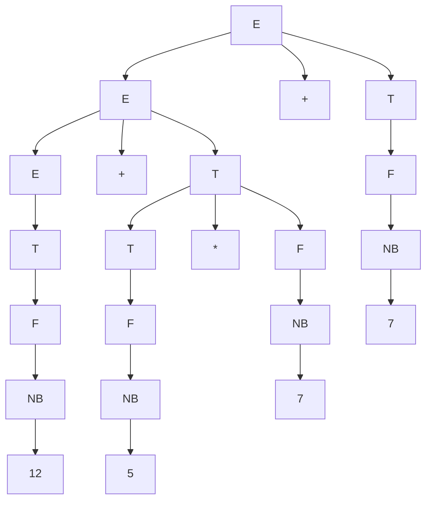
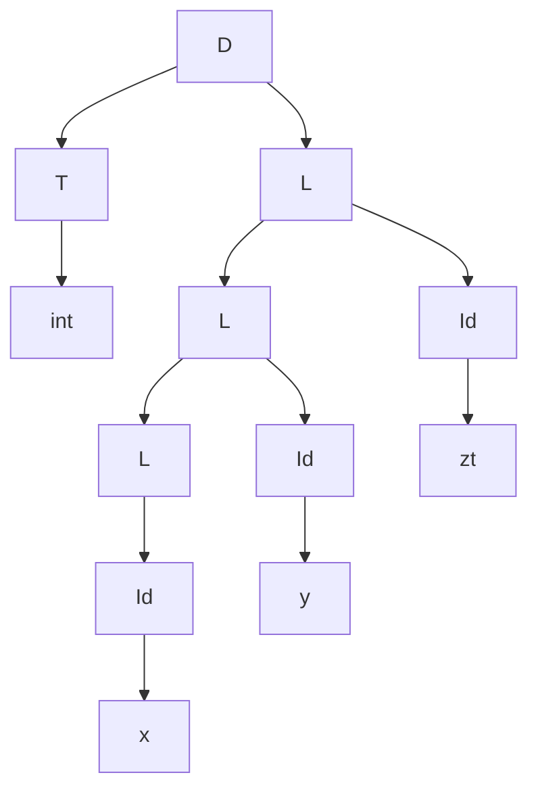
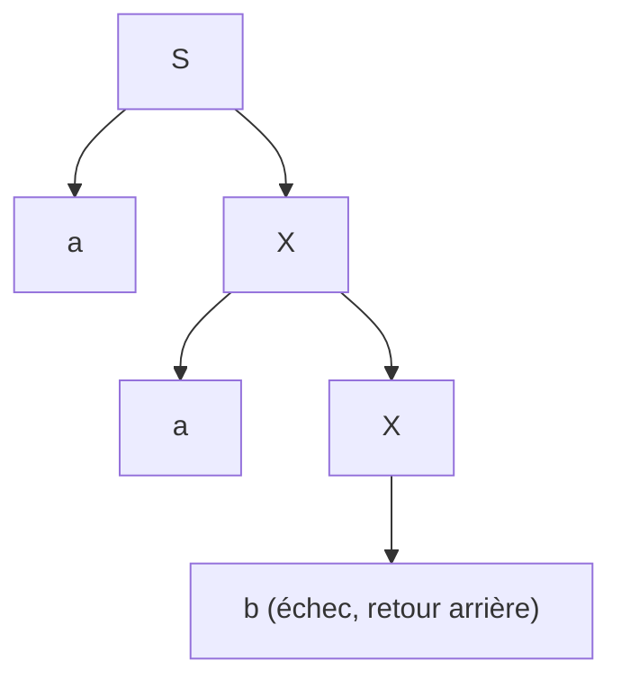
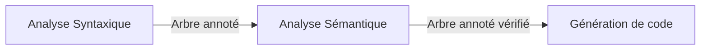
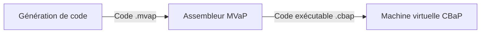

**Objectif :** Apprendre les différents concepts d'un compilateur. Ici, nous nous restreignons à :
- certaines constructions des langages de programmation ;
- certaines étapes d'un compilateur :
  - analyse lexicale ;
  - analyse syntaxique ;
  - analyse sémantique ;
  - génération de code.

$$\text{Compilateur} = \text{traducteur d'un langage } L \text{ vers un langage } L'$$

**Pratique :**
- Le langage en entrée du compilateur est $L$ : un langage conçu par l'étudiant intégrant les constructions demandées.
- Le langage cible $L'$ est le langage d'une machine virtuelle appelée *Machine Virtuelle à Programmer* (MVaP).
- L'outil de génération du compilateur est **ANTLR**, et les langages d'écriture seront : **Java** et **ANTLR**.
- La syntaxe du langage de programmation à concevoir sera décrite avec une grammaire hors-contexte. Certaines constructions étant ambiguës, nous verrons des heuristiques pour les rendre non ambiguës.

---

# Analyse lexicale



- Un **token** (jeton) est un ensemble d'informations qui caractérise un objet terminal de la grammaire hors-contexte décrivant le langage.
- Un **lexème** est une suite de caractères.
- Une **unité lexicale** est un ensemble de lexèmes.

**Exemples :** 
Soit la grammaire : $E \to E + E \mid E * E \mid nb$
Code source : `nb + nb + nb * nb * nb + nb`

On a **11 lexèmes** : 
- 6 occurrences de `nb`
- 3 occurrences de `+`
- 2 occurrences de `*`

On a **2 unités lexicales** (ou 3 selon si `+` et `*` sont regroupés en `OP`) :
- une correspondant au lexème `nb` ;
- une correspondant aux lexèmes `+` et `*`.

Autre exemple : $F \to F * F \mid F + F \mid I \ ; \quad I \to 0I \mid 1I \mid \epsilon$
Exemple de mot : `0+1*01+110+111`

Un **Token** est composé de :
- l'unité lexicale $T$ ;
- le lexème de $T$ ;
- d'autres informations utiles :
  - numéro de ligne, numéro de colonne ;
  - valeur entière associée (si le lexème représente un entier).

Un analyseur lexical produit un flux de tokens pour l'analyseur syntaxique.

**Comment faire :**
- Chaque unité lexicale du langage est décrite par une expression régulière.
- Un analyseur lexical correspond à l'union des automates à états finis associés aux unités lexicales, complétée par des actions permettant de construire les jetons reconnus.

## Cas de l'intersection des unités lexicales

L'analyseur lexical doit résoudre le problème de l'intersection de deux unités lexicales (laquelle choisir lorsqu'un mot appartient à deux langages réguliers distincts).

**Solution facile :**
- Ordonner les règles des unités lexicales.
- Lorsqu'un lexème appartient à plusieurs unités lexicales, choisir la règle la plus prioritaire (souvent la première définie).

**Dans ANTLR :**
L'ordre choisi par ANTLR est l'ordre d'écriture des règles dans le fichier.
```antlr
BEGIN : 'begin';
ID    : [a-z]+;
```
Il y a 2 unités lexicales : `BEGIN` et `ID`. Le lexème `"begin"` sera considéré comme un lexème de `BEGIN` car sa règle apparaît en premier.

## Cas d'un lexème préfixe d'un autre

- **Greedy (glouton) :** On lit le lexème le plus long possible (solution par défaut d'ANTLR).
- **Non-Greedy (non glouton) :** On prend le lexème le plus petit (dès qu'une suite de caractères est acceptée, on arrête la lecture).

**Exemples :**
1. `beginner` avec la méthode gloutonne sera reconnu comme un seul lexème de `ID`. Avec une approche non gloutonne, on pourrait obtenir 2 lexèmes : `"begin"` et `"ner"`.
2. `STRING : '"' .* '"' ;` sur l'entrée `"m1""m2"` :
   - **Glouton :** 1 seul lexème `"m1""m2"`.
   - **Non glouton** (`STRING : '"' .*? '"' ;`) : 2 lexèmes `"m1"` et `"m2"`.
3. Si l'on veut autoriser les guillemets échappés comme caractères dans une chaîne :
   ```antlr
   STRING : '"' (ESC | .)* '"' ;
   ESC    : '\\"' | '\\\\' ;
   ```
   Exemple : `"w1\"w2"` sera reconnu comme un seul lexème valide.

---

# Analyse syntaxique



La syntaxe d'un langage de programmation est décrite avec une grammaire hors-contexte.  
On demande à l'analyseur syntaxique de calculer quelques valeurs pour chaque nœud de l'arbre de dérivation : ces valeurs sont appelées **attributs**. C'est l'annotation de la grammaire hors-contexte qui permet de calculer ces valeurs ; on parlera alors de **grammaire annotée** (ou attribuée).  
*(Exemple : annoter une parenthèse ouvrante avec un numéro pour indiquer si elle possède une parenthèse fermante correspondante).*

Ce sera **ANTLR** qui générera l'analyseur lexical et syntaxique. Il suffit de lui fournir la grammaire (annotée ou non) et les unités lexicales. Les unités lexicales sont généralement données en fin de fichier et leur nom est écrit en `MAJUSCULE`.

**Exemple dans ANTLR :**
```antlr
grammar Ex_parser; // Ex_parser = nom de la grammaire / du compilateur

// Règles de l'analyseur syntaxique
expr       : (NUMBER | ID) suite_expr ;
suite_expr : OP (NUMBER | ID) suite_expr | ;

// Règles de l'analyseur lexical
NUMBER : ('0'..'9')+ ;
ID     : ('a'..'z')+ ;
OP     : '+' | '*' | '/' | '-' ;
```

**Exemple d'exécution sur `12+gol` :**
On a 3 lexèmes : `12`, `+`, `gol`.

Liste des tokens générés par ANTLR :
- `[@0,0:1='12',<1>,1:0]` :
  - `@0` : numéro du token ;
  - `0:1` : intervalle d'indices des caractères du lexème ;
  - `'12'` : valeur (texte) du lexème ;
  - `<1>` : numéro de l'unité lexicale (`NUMBER`) ;
  - `1:0` : numéro de ligne, numéro de colonne.
- `[@1,2:2='+',<3>,1:2]`
- `[@2,3:5='gol',<2>,1:3]`

**Arbre de dérivation :**


---

En cours de théorie des langages, on voit l'équivalence entre une grammaire hors-contexte et un automate à pile. La construction est polynomiale en la taille de la grammaire, mais l'automate est non déterministe, ce qui donne par défaut un algorithme en temps exponentiel $O(d(G)^n)$ pour $n$ la taille du mot en entrée et $d(G)$ la taille maximale d'une règle.

**Théorème (Algorithme CYK / Earley) :** 
Il existe un algorithme $\mathcal{A}$ tel que :
- **Entrée :** une grammaire hors-contexte $G$ et un mot $u$.
- **Sortie :** $u \in L(G)$ (et un arbre de dérivation) ou $u \notin L(G)$.
- **Complexité :** $\mathcal{A}$ s'exécute en temps $O(f(|G|) \cdot |u|^3)$.

Si $G$ était « déterministe », nous aurions un algorithme en temps linéaire $O(|u|)$, mais ce n'est pas le cas de toutes les grammaires.

**Solution :** Utiliser des heuristiques pour calculer en temps linéaire un arbre de dérivation sur des sous-classes de grammaires. On distingue 2 grandes familles :
- **LL(k) :** dérivation gauche, on lit $k$ tokens à l'avance (lookahead) pour choisir la règle sans ambiguïté (méthode utilisée par défaut par ANTLR).
- **LR(k) :** dérivation droite inversée (ascendante), on lit $k$ tokens à l'avance.

---

# Grammaires attribuées (ou annotées)

**Définition :** Une grammaire attribuée est une grammaire hors-contexte où l'on associe à chaque symbole (terminal ou non-terminal) des étiquettes appelées **attributs**.  
L'annotation de la grammaire consiste à donner les règles sémantiques de calcul des valeurs de ces attributs pour chaque nœud de l'arbre de dérivation.

**Exemple (Évaluation d'expressions arithmétiques) :**
$$
\begin{aligned}
E &\to E + T \mid T \\
T &\to T * F \mid F \\
F &\to (E) \mid NB \\
NB &\to (0\dots9)+
\end{aligned}
$$

Arbre de dérivation pour `12+5*7+7` :


On associe à chaque variable un attribut nommé `val`, de type entier (on indice les variables redondantes dans une même règle pour les distinguer) :
- $E \to E_1 + T \quad \{E.val = E_1.val + T.val\}$
- $E \to T \quad \{E.val = T.val\}$
- $T \to T_1 \times F \quad \{T.val = T_1.val \times F.val\}$
- $T \to F \quad \{T.val = F.val\}$
- $F \to (E) \quad \{F.val = E.val\}$
- $F \to NB \quad \{F.val = NB.val\}$
- $NB \to (0\dots9)+ \quad \{NB.val = \text{ObtenirEntier}(NB.txt)\}$

On distingue **2 types d'attributs** :
1. **Attribut synthétisé :** Attribut dont la valeur est calculée à partir des attributs des nœuds fils (ex. : `val` dans l'exemple précédent).
2. **Attribut hérité :** Attribut calculé à partir des attributs du nœud père ou des frères (ex. : propagation du type dans une déclaration de variables).

**Exemple d'attribut hérité :**
$$
\begin{aligned}
D &\to T \ L \\
T &\to \text{int} \mid \text{float} \\
L &\to L, Id \mid Id \\
Id &\to (a\dots z)+
\end{aligned}
$$

Pour `"int x,y,zt"` :


On veut associer à chaque variable son type (sous forme de chaîne de caractères, attribut `t`) :
- $T \to \text{int} \ \{T.t = \text{"E"}\} \mid \text{float} \ \{T.t = \text{"R"}\}$
- $D \to T \ L \ \{L.t = T.t\}$
- $L \to L_1, Id \ \{L_1.t = L.t \ ; \ Id.t = L.t\}$
- $L \to Id \ \{Id.t = L.t\}$

## Calcul des attributs

- Une grammaire est dite **S-attribuée** si elle ne contient que des attributs synthétisés.  
  *Proposition :* Le calcul des attributs d'une grammaire S-attribuée se fait de manière ascendante (des feuilles vers la racine).
- Une grammaire est dite **L-attribuée** si le calcul de chaque attribut hérité d'un nœud ne dépend que des attributs de son père et des nœuds situés à sa gauche (avant lui dans l'ordre préfixe).  
  *Proposition :* Ces attributs peuvent être calculés en même temps que la construction de l'arbre lors d'une dérivation gauche.
- *Remarque :* Toute grammaire S-attribuée est également L-attribuée.

---

# Heuristiques pour l'analyse syntaxique

Rappel : Pour une grammaire quelconque, on peut décider si $w \in L(G)$ en temps $O(f(|G|) \cdot |w|^3)$.

Il existe **2 grandes approches** d'analyse :
1. **Top-Down (descendante) :** On commence par l'axiome (variable de départ $S$), et on essaie de trouver la séquence de règles permettant de générer $w$.
2. **Bottom-Up (ascendante) :** On part des feuilles (le mot $w$) et on essaie de réduire les sous-chaînes à l'aide des règles jusqu'à remonter à la racine $S$. *(Ce genre d'analyseur, comme LR(k), reconnaît une classe plus large de grammaires déterministes que les analyseurs Top-Down).*

## 1. Top-Down avec backtracking (retour sur trace)

Principe pour construire un arbre de dérivation :
1. Toujours dériver le non-terminal le plus à gauche en testant les règles dans un ordre fixe.
2. Lorsqu'on est bloqué (échec de correspondance), on revient en arrière et on essaie la règle suivante.

**Exemple :** $w = aacba$ avec $S \to aX \mid aaY$, $X \to aX \mid bY$, $Y \to cbY \mid a$.
L'analyseur essaie d'abord $S \to aX \to aaX \to aaaX$ (échec), revient en arrière pour tester $S \to aX \to aaX \to aabY$ (échec), puis remonte jusqu'à $S$ pour finalement trouver la bonne dérivation : $S \to aaY \to aacbY \to aacba$.



**Problèmes :**
- Cet algorithme s'exécute en temps **exponentiel** dans le pire des cas.
- Si $G$ est **récursive à gauche** ($A \to^* A\alpha$), l'algorithme boucle à l'infini sans pouvoir dériver.

**Proposition :** Pour toute grammaire $G$, il existe une grammaire $G'$ non récursive à gauche telle que $L(G) = L(G')$.

### Algorithme d'élimination de la récursivité à gauche

Soit $A$ une variable admettant une récursivité à gauche directe :
$$A \to A\alpha_1 \mid A\alpha_2 \mid \dots \mid A\alpha_p \mid w_1 \mid \dots \mid w_l$$
(où les $w_i$ ne commencent pas par $A$).
- On ajoute une nouvelle variable $Z$.
- On remplace les règles de $A$ par :
  - $A \to w_1 Z \mid \dots \mid w_l Z$ *(ou sans $Z$ si $Z \to \epsilon$)*
  - $Z \to \alpha_1 Z \mid \alpha_2 Z \mid \dots \mid \alpha_p Z \mid \epsilon$

Pour éliminer la récursivité à gauche générale (indirecte), on numérote les variables $A_1, A_2, \dots, A_n$ (en supposant qu'il n'y a pas de cycles $A \to^* A$) :
```text
Pour i de 1 à n Faire
    Pour j de 1 à i-1 Faire
        Remplacer chaque règle Ai -> Aj α par les règles Ai -> β1 α | β2 α | ...
        (où Aj -> β1 | β2 | ... sont toutes les règles actuelles de Aj)
    Fin Pour
    Éliminer la récursivité à gauche directe de Ai
Fin Pour
```

**Exemple :**
$S \to Xa \mid b$
$X \to Sd \mid Xc \mid \epsilon$
- Pour $i=1$ ($S$) : pas de variable d'indice inférieur, pas de récursivité directe.
- Pour $i=2$ ($X$) : on substitue $S$ dans $X \to Sd$, ce qui donne $X \to Xad \mid bd \mid Xc \mid \epsilon$.
- On élimine la récursivité directe sur $X$ en introduisant $Z$ :
  $$G'' : \begin{cases} S \to Xa \mid b \\ X \to bdZ \mid Z \\ Z \to adZ \mid cZ \mid \epsilon \end{cases}$$

## 2. Factorisation à gauche et Top-Down prédictif

Pour éviter le backtracking exponentiel, on cherche à deviner la règle à appliquer en lisant uniquement les $k$ prochains tokens. On peut **factoriser à gauche** la grammaire pour repousser les choix vers les feuilles.

Soit $A \to \alpha w_1 \mid \dots \mid \alpha w_k$ où $\alpha \neq \epsilon$ est le plus long préfixe commun. On réécrit :
- $A \to \alpha A'$
- $A' \to w_1 \mid \dots \mid w_k$

Si la lecture de $k$ tokens suffit toujours à décider de manière unique quelle règle appliquer, la grammaire est dite **LL(k)**.  
*(Exemple : $S \to *EE \mid +EE \mid a$ est dans $LL(1)$).*

---

# Résoudre certaines ambiguïtés

**Théorème :** Il est indécidable de savoir si un langage algébrique (donné par une grammaire) admet une grammaire non ambiguë (certains langages sont inhéremment ambigus).

Nous allons étudier 3 cas classiques d'ambiguïté et comment les résoudre :
1. L'associativité
2. La priorité des opérateurs
3. Le parenthésage (ex. : le *dangling else*)

## 1. Associativité
Une opération est associative si l'ordre d'exécution n'affecte pas le résultat mathématique, mais en compilation, il faut fixer un ordre (généralement l'associativité à gauche) pour construire un arbre unique.

**Grammaire ambiguë :** $E \to E + E \mid (E) \mid nb$

**Solution (forcer l'associativité à gauche) :** Introduire une nouvelle variable $F$ représentant l'opérande de droite :
$$E \to E + F \mid F \ ; \quad F \to (E) \mid nb$$

## 2. Priorité des opérateurs
**Grammaire ambiguë :** $E \to E + E \mid E * E \mid (E) \mid nb$

**Règles :**
- On fixe une associativité (ex. : à gauche) pour chaque opérateur.
- On stratifie la grammaire : les opérations de plus faible priorité sont dérivées en premier (près de la racine), tandis que les opérations de plus haute priorité sont dérivées plus bas (près des feuilles).

**Grammaire non ambiguë :**
$$
\begin{aligned}
E &\to E + T \mid T \\
T &\to T * F \mid F \\
F &\to (E) \mid nb
\end{aligned}
$$

## 3. Parenthésage (Problème du « Si ... Alors ... Sinon »)
**Grammaire ambiguë :**
$$I \to \text{si } E \text{ alors } I \mid \text{si } E \text{ alors } I \text{ sinon } I \mid a \quad (\text{avec } E \to c)$$

**Problème :** Dans `si c1 alors si c2 alors a sinon a`, à quel `si` est rattaché le `sinon` ?  
**Solution :** Faire un choix autoritaire (par convention dans les langages comme C ou Java, un `sinon` est toujours rattaché au `si` ouvert le plus proche).

**Grammaire non ambiguë :**
$$
\begin{aligned}
I &\to A \mid B \\
A &\to \text{si } c \text{ alors } A \text{ sinon } A \mid a \quad (\text{instructions « fermées » / complètes}) \\
B &\to \text{si } c \text{ alors } I \mid \text{si } c \text{ alors } A \text{ sinon } B \quad (\text{instructions « ouvertes »})
\end{aligned}
$$

---

# Analyse sémantique et génération de code



## Analyse Sémantique

**Objectif :** Effectuer les contrôles que la grammaire hors-contexte ne peut pas exprimer et donner du sens aux constructions du langage. La grammaire attribuée facilite ces vérifications.

**Exemples de vérifications sémantiques :**
1. **Vérification des types :**
   - `x + 5` : `x` est-il bien un entier ?
   - `f(5, 6)` : `f` est-elle bien une fonction ? Prend-elle 2 arguments de type entier ?
2. **Affectation (assignation) :**
   - `x = 7` : la variable `x` a-t-elle été déclarée ? Est-elle compatible avec le type de `7` ?
3. **Résolution des identifiants :** Récupérer l'adresse mémoire d'une variable ou l'étiquette (adresse) d'une fonction.

## Génération de code

$$\text{Code source} \longrightarrow \text{Langage machine (MVaP)}$$

**Principe :** Parcours de l'arbre de dérivation attribué (généralement *bottom-up*) pour synthétiser les instructions machines.  
**Prérequis :** Comprendre la gestion de la mémoire de la machine cible et son jeu d'instructions.

### La machine virtuelle MVaP

- Utilise une **pile adressable** comme mémoire principale.
- Chaque instruction prend ses opérandes au sommet de la pile et y empile son résultat.
- Dispose d'instructions de calcul arithmétique, logique, de manipulation de mémoire et de saut.

#### Mémoire de la MVaP
- La mémoire est divisée en mots (la taille d'un mot correspond à la taille d'un entier).
- Chaque mot est adressé par un entier ($0$ à $\text{taille mémoire} - 1$).
- Elle est divisée en 2 zones : le **bloc d'instructions** (programme) et le **bloc mémoire de données** (pile).
- Pas d'allocation dynamique : exécution séquentielle et mono-programme.
- **Registres spéciaux :**
  - `pc` (*Program Counter*) : compteur ordinal (adresse de l'instruction courante).
  - `sp` (*Stack Pointer*) : pointeur de sommet de pile (taille actuelle de la pile).
  - `gp` (*Global Pointer*) : adresse de base pour les variables globales.
  - `fp` (*Frame Pointer* / `lp`) : adresse de base pour le contexte local d'une fonction.

#### Exécution sur MVaP


Commandes d'exécution :
```bash
java MVaPAssembleur code.mvap       # Génère le fichier code.mvap.cbap
java CBaP -d code.mvap.cbap         # Exécute le programme (-d pour le mode debug)
```

#### Quelques instructions MVaP
- `READ` : lit un entier sur l'entrée standard et l'empile.
- `WRITE` : écrit la valeur au sommet de la pile sur la sortie standard (sans dépiler, selon les versions, ou suivi de `POP`).
- **Opérations arithmétiques et comparaisons :** `ADD`, `SUB`, `DIV`, `MUL`, `EQUAL`, `SUP`, `INF`, etc.  
  *(Dépilent les 2 valeurs au sommet, effectuent l'opération `sous_sommet op sommet`, et empilent le résultat).*
- `PUSHI n` : empile la constante entière `n`.
- `POP` : dépile le sommet de la pile.
- `JUMP n` : saut inconditionnel vers l'étiquette/adresse `n`.
- `HALT` : arrête l'exécution de la machine.

**Exemple 1 :** Calcul de $5 \times 3 + 2 / 7$
```text
PUSHI 5
PUSHI 3
MUL
PUSHI 2
PUSHI 7
DIV
ADD
HALT
```

**Exemple 2 (Grammaire attribuée pour la génération de code) :**
- $E \to E_1 + E_2 \quad \{E.code = E_1.code + E_2.code + \text{"ADD}\backslash{n}"\}$
- $E \to E_1 * E_2 \quad \{E.code = E_1.code + E_2.code + \text{"MUL}\backslash{n}"\}$
- $E \to INT \quad \{E.code = \text{"PUSHI "} + INT.text + "\backslash{n}"\}$

---

### Traduction des 4 constructions principales

#### 1. Expressions arithmétiques et booléennes
On suit l'arbre de dérivation de bas en haut. La machine MVaP ne possède pas de type booléen natif : on utilise donc les entiers (`0` pour Faux, `1` pour Vrai) et des opérations arithmétiques :
- **Faux** $\to$ `0`
- **Vrai** $\to$ `1`
- **ET logique (`&&`)** $\to$ multiplication (`MUL`)
- **OU logique (`||`)** $\to$ addition (`ADD`), suivie d'une comparaison (`PUSHI 1`, `SUPEQ` ou similaire) pour ramener toute valeur $\ge 1$ à `1`.
- **Négation (`!`)** $\to$ `1 - valeur` (ex. : `PUSHI 1`, empiler la valeur, `SUB`).

**Exemple en ANTLR :**
```antlr
exprBool returns [String code]
    : 'Vrai'               { $code = "PUSHI 1\n"; }
    | 'Faux'               { $code = "PUSHI 0\n"; }
    | b1=exprBool 'et' b2=exprBool { $code = $b1.code + $b2.code + "MUL\n"; }
    | b1=exprBool 'ou' b2=exprBool { $code = $b1.code + $b2.code + "ADD\nPUSHI 1\nSUPEQ\n"; }
    ;
```

#### 2. Variables globales et Table des Symboles
Comme en C, chaque variable correspond à un emplacement mémoire dont le contenu est la valeur de la variable.
- **Variables globales :** visibles partout, allouées au tout début de la pile (à partir de l'adresse relative `0`).
- **Variables locales :** visibles uniquement dans le bloc/la fonction courante (gérées via le registre `fp`).

**Instructions d'accès aux variables globales :**
- `PUSHG n` : lit la valeur située à l'adresse globale `n` et l'empile.
- `STOREG n` : dépile le sommet de pile et le stocke à l'adresse globale `n`.

**Exemple :** `x = x + 5` (en supposant `x` à l'adresse `10`) :
```text
PUSHG 10
PUSHI 5
ADD
STOREG 10
```

**Allocation mémoire et Table des Symboles :**
La machine dispose d'une MMU (*Memory Management Unit*) qui traduit les adresses relatives en adresses physiques. Pour connaître l'adresse attribuée à chaque variable, le compilateur effectue toutes les déclarations globales au début du programme (en empilant des valeurs initiales avec `PUSHI 0` ou `PUSHF 0.0`) et incrémente un compteur d'adresse.

*Exemple d'adresses :*
- `int x, y;` $\to$ `x` à l'adresse `0`, `y` à l'adresse `1` (1 mot chacun).
- `float z;` $\to$ `z` à l'adresse `2` (occupe 2 mots sur MVaP).
- `int t;` $\to$ `t` à l'adresse `4`.

Ces informations (nom, type, adresse) sont stockées dans une **Table des Symboles** (ex. : `HashMap` en Java) pour permettre les vérifications sémantiques et la génération des adresses.

**Exemple en ANTLR :**
```antlr
grammar ExParser;

@header {
    import java.util.HashMap;
}

@members {
    HashMap<String, Integer> tableSymboles = new HashMap<String, Integer>();
    int adresseCourante = 0;
}

start : declaration* instruction* EOF ;

declaration 
    : TYPE ID ';' {
        tableSymboles.put($ID.text, adresseCourante++);
        // Génère PUSHI 0 pour réserver l'emplacement
    }
    ;

instruction returns [String code] : /* ... */ ;
```

**Trace de compilation :**
```text
// Code source      // Code MVaP      // Table des symboles
int x;              PUSHI 0           (x -> 0)
int y;              PUSHI 0           (y -> 1)
int z;              PUSHI 0           (z -> 2)

z = x + y;          PUSHG 0
                    PUSHG 1
                    ADD
                    STOREG 2

x = z - x;          PUSHG 2
                    PUSHG 0
                    SUB
                    STOREG 0
```

#### 3. Structures de contrôle (Conditionnelles et Boucles)
Pour modifier le flot d'exécution, on utilise des **étiquettes** (`LABEL n`) et des **instructions de saut** :
- `LABEL n` : marque une position dans le code (l'assembleur associera un numéro d'instruction à `n`).
- `JUMP n` : saut inconditionnel vers `LABEL n`.
- `JUMPF n` : saut conditionnel. Dépile le sommet de pile : si la valeur est fausse (`0`), saute à `LABEL n` ; sinon (vraie), continue séquentiellement.

**Exemple (`Si ... Alors ... Sinon`) :**
```text
int x;
si 5 == 6 alors
    x = 5;
sinon
    x = 7;
```

Code MVaP généré :
```text
PUSHI 0      // Déclaration de x (adresse 0)
PUSHI 5
PUSHI 6
EQUAL        // Empile 0 (faux)
JUMPF 0      // Si faux, sauter au bloc sinon (LABEL 0)
PUSHI 5
STOREG 0
JUMP 1       // Sauter à la fin du Si (LABEL 1)
LABEL 0
PUSHI 7
STOREG 0
LABEL 1
HALT
```

#### 4. Fonctions
Une fonction est un bloc de code identifié par un nom (associé à une étiquette `LABEL n`), prenant des paramètres en entrée et retournant un résultat.

**Mécanisme matériel de MVaP (`CALL` et `RETURN`) :**
- `CALL n` : sauvegarde l'adresse de retour (`pc + 1`) et l'ancien pointeur de base (`fp`) sur la pile, fixe le nouveau `fp` au sommet de pile actuel (`sp`), puis saute à `LABEL n`.
- `RETURN` : restaure l'ancien `fp` et retourne à l'adresse sauvegardée.

**Convention d'appel (protocole entre appelant et appelée) :**
1. **Avant l'appel (code de l'appelant) :**
   - Réserver un emplacement sur la pile pour la **valeur de retour** (ex. : `PUSHI 0`).
   - Empiler les **arguments** dans l'ordre de déclaration.
   - Exécuter `CALL n`.
2. **Dans la fonction (code de l'appelée) :**
   - Accéder aux arguments et à la valeur de retour via des adresses relatives à `fp` :
     - `PUSHL k` : empile la valeur située à l'adresse `fp + k`.
     - `STOREL k` : dépile le sommet et l'écrit à l'adresse `fp + k`.
   - *(Note : `fp - 1` et `fp - 2` contiennent généralement les sauvegardes système de `fp` et `pc`, les arguments se trouvent donc aux décalages négatifs précédents, ex. `fp - 3`, `fp - 4`, etc., et la valeur de retour juste avant).*
   - Terminer par `RETURN`.
3. **Après l'appel (code de l'appelant) :**
   - Dépiler les arguments devenus inutiles (`POP` autant de fois qu'il y a d'arguments) afin que la valeur de retour se retrouve au sommet de la pile.

**Exemple d'appel d'une fonction à 2 arguments retournant le premier :**
```text
// Code de l'appelant
PUSHI 0      // Réservation pour la valeur de retour
PUSHI 5      // Empilement argument 1
PUSHI 6      // Empilement argument 2
CALL 5       // Appel de la fonction étiquetée 5
POP          // Nettoyage argument 2
POP          // Nettoyage argument 1 (la valeur de retour reste au sommet)
// ...

// Code de la fonction (LABEL 5)
LABEL 5
    PUSHL -4     // Récupère l'argument 1 (selon l'architecture exacte de la frame MVaP)
    STOREL -5    // Écrit le résultat dans l'espace de retour réservé
    RETURN
```