Objectif : apprendre les different concept d'un compilateur ici on se restreint a:

- à certain contruction des language de programation

- à certain etape de'un compilateur

  - analyse lexicale

  - analyse syntaxique

  - analyse sementique

  - generation de code

compilateur = traducteur d'un language $L$ vers un language $L'$ 

**Pratique :**

Un language en entre du compilateur est $L$ : language concu par l'etudiant avec en entree des contruction demandées 

Language cilce $L'$ = language d'une machine virtuelle apelle Machine Virtuelle a Programer.

Outil de generation du compilateur = ANTRL, les language d'ecriture seront : java, ANTRL.

La syntaxe du language de programation à concevoir sera decrite avec une grammaire hors-contexe. Certaines contruction sont ambigue, on va voir des heuritiques pour les rentre non-ambigues

# Analyse lexicale

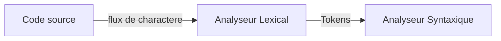

Un **token** est un ensemble de'information qui caracterise un objet terminale de la grammaire hors contexte decrivant le language.

Un **lexeme** = suite de charactere.

une **unite lexicale** = un ensemble de lexèmes.

**Exemples :** $ E \to E+E|E*E|nb$

code source : nb + nb + nb \* nb \* nb + nb

On a 11 lexeme : 

- 6 ocurence de nb

- 3 occurence de +

- 2 occurence de \*

On a 2 unite lexicale :

- un correspond au lexeme nb

- un correspond au lexeme + et \*

$F \to F*F|F+F|I; \ \ I\to 0I|1I|\epsilon$

ex: 0+1*01+110+111

#arbre de derivation

un **Token** est compose de :

- unite lexical T

- lexeme de T

- d'autre inforamation pour aider :

  - numero de ligne, numero de colone

  - valeur entiere pour un lexeme 

  - representer un entier

Un analyseur lexical va produire un flux de token pour l'anaylseur syntaxique 

Comment faire:

- chaque unite lexicale du language est decrite par une expression reguliere

- un analyseur lexical = union des automates à etat finis associe aux unite lexicale + des action permettant de calculer les jetons de $n$-ème reconnus

## Cas de l'intersection des unite lexicales

solution facile :

- ordonner les regle des unite lexicales 

- lorsqu' un lexeme appartient a plusieur unite lexicale, choisir la plus petite.

ANTLR :

l'ordre choisi par ANTLR = l'ordre d'ecriture de regle.

Ex: BEGIN : 'begin'; ID:[a-z]+

2 unite lexicales: BEGINet ID le lexere "begin" sera considere comme lexeme de BEGIN 

## Cas lexeme prefixe d'un autre

- Greedy:on lit le lexeme le plus long possible. (solution par default de ANTLR)

- Non-Greedy: prendre le lexeme le plus petit .(des qu' une suite de caractere est accepte, on arrete la lecture)

---

L'analyseur lexical doit resoudre 2 probleme :

- l'intersection de 2 unite lexicales. Laquelle choisir

---

EX : beginner avec la methode gloutone sera reconnue comme un lexeme de ID.  
avecc la methode non-gloutone, on pourrait avoir 2 lexeme "begin" et "non".

EX2 : STRING : ' " ' \* ' " ' ; "m1""m2".  

- glouton 1 seule lexeme "m1""m2"  

- non gloutone : 2 lexeme "m1" et "m2"

EX3: 

STRING : ' ".\*" ' mot "w1""w2" lexele associe "w1""w2"

Si on veux le mode non glouton  STRING :' ".\*?" ' les lexeme sont "w1" et "w2"

EX4: Si on veux des guillemet comme caractere : STRING ' "(ESC|.)\*" '

ESC : ' \\\" ' | ' \\\\ \\\ ' 

ex: "w1\\\"w2" le lexeme sera "w1"w2"

# Analyse syntaxique

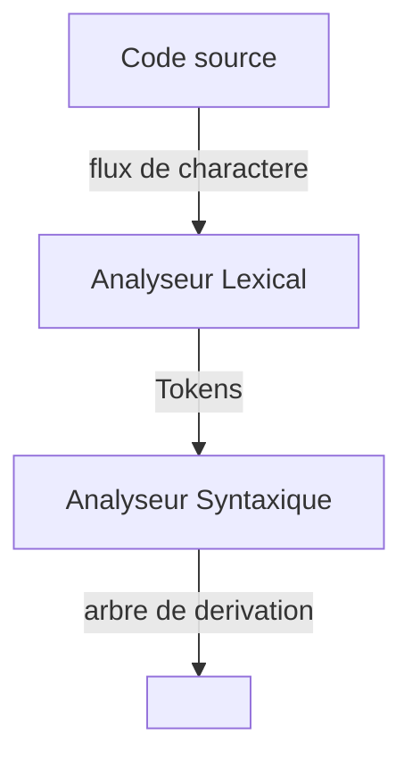

La syntaxe d'un language de programation est decrite avec une grammaire hors contexte.  
On demande à l'analyseur syntaxique de calculer quelques valuer, pour chaque noeud de l'arbre de derivarion, ces valeur sont appelées attribut. C'est l'annotation de la gramaire hors contexte qui permet de calculer ces valeur on parlera de grammaire annotée.

ex : anote une parentrese avec un numero pour dire si elle en a une fermermante.

Ce sera ANTLR qui generera l'analyseur lexical et syntaxique. Il suffit de lui donner la grammaire (anote ou non) et les unités lexicales. Les unite lexicales sont données en fin de fichier et leur nom en MAJUSCULE.

Exemple dnas ANTLR:

**grammar** Ex_parser; // Ex_parser=som du compilateur.

//regle de l'analyseur syntaxique

expr:(NUMBER | ID) suite_expr;

suite_expr : OP(NUMBER | ID ) suite_expr | ;

// regle de l'analyseur lexical

NUMBER : ('0' ... '9')+ ;

ID : ('a' ... 'z')+;

OP: '+' | '\*' | '/' | '-';

---

Ex: 12 + gol

on a 3 lexeme :

- 12

- + 

- gol

Liste des lexemes :

- **[@0,0:1='12',<1>,1:0] :**

  - @0  numero du token

  - 0:1 intervalle de caracte du lexeme

  - '12' valuer du lexeme

  - <1> numero de l'unite lexicale

  - 1:0 numero de ligne , numero de colone

- [@1,2:2='+',<3>,1:2] 

- [@3,3:5='gol',<2>,1:3]

Arbre de derivation:

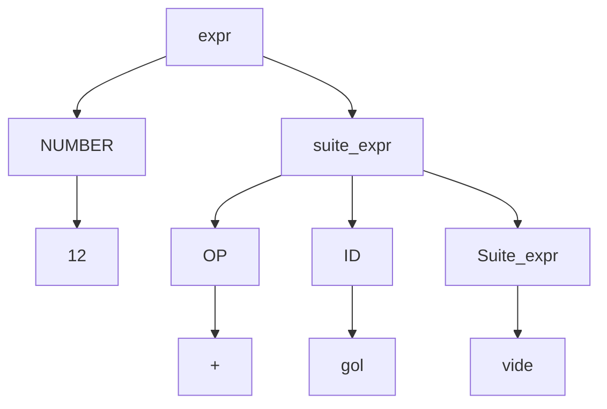

---

En cours de grammaire vous avez l'equivalence entre une grammaire hors contexte et automate à pile. La contruction est polynomiale en la taille dela grammaire. Mais l'automate est non-deterministe et donc on a par default un algorithme en temps $d(G)^n$ pour $n$ la taille du mot en entree et $d(G)$ la taille maxiamle de'une regle.

**Theoreme :** 

Il exite un algorithme $\mathcal{A}$ tq :

- entrée : 

  - une grammaire hors contexte $G$.

  - un mot de $u$

- suite : $(u \in L(G) et 1 arbre de derivation ou u \notin L(G))$

$\mathcal{A}$ s'execute en temps $f(|G|). |u|³$

Cet algorithme si $G$ etait "deterministe" on aurait un algorithme linéaire.  
Mais pas le cas de toutes les grammaires.

Solution : heuristique pour calculer en temps lineaire un arbre de derivation.

2 familles :

- LL(k) derivation gauche et on lit k caractere et on n'a plus le choix de la regle. (defaut ANTLR)

- LR(k)

# Grammaire Attribuées (ou annotées)

**Definition :** Une grammaire attribuées est un grammaire hors contexte ou on associe à chaque non-terminal des etiquettes, appelée attributs.  
L'annotation de la grammaire consistera à donner les regles de calcul des valuer des attributs.

Les règles de calcul permettront d'associer à chaque occurence de la variable et donc chaque noeud de l'arbre de derivation associe a cette variable, les valeur des attribut de la variable.

Ex:

$$
E \to E +T |T \\
T \to T*F|F\\
F\to (E)|NB\\
NB\to (0...9)+
$$

ex: 12+5*7+7

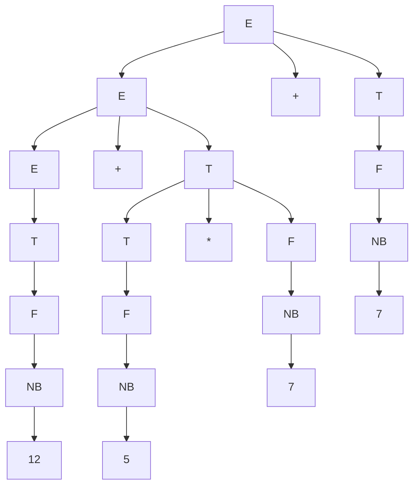

on assosie a chaque varriable dans cet exemple un atribut  nomme val, de type entier.

$E \to E_1+T \space \{E.val =E_1.val+T.val\}$

$E \to T \space \{E.val=T.val\}$

$T \to T_1 \times F \space \{T.val=T_1.val \times F.val\}$

$T \to F \space \{T.val = F.val\}$

$F \to (E) \space \{F.val = (E.val)\}$

$F \to I \space \{F.val = I.val\}$

$I \to (0...9)+ \space \{I.val=ObtenirEntier(I.txt)\}$

on numerote les variable redoant=dante pour quelle soit unique.

On distingue 2 type d'atribut:

- attribut synthetise = atribut dont les valuer peuvent etre calcule a partir des attribut des fils.  
  ex : attrb.val de l'exemple precedent

- attributs herite: attribue calcule a partir d'atribut du pere.  
  ex : $D \to T L \\ T \to int | float\\ L \to L,Id|Id\\Id \to (a...z)^+$

"int x,y,zt"

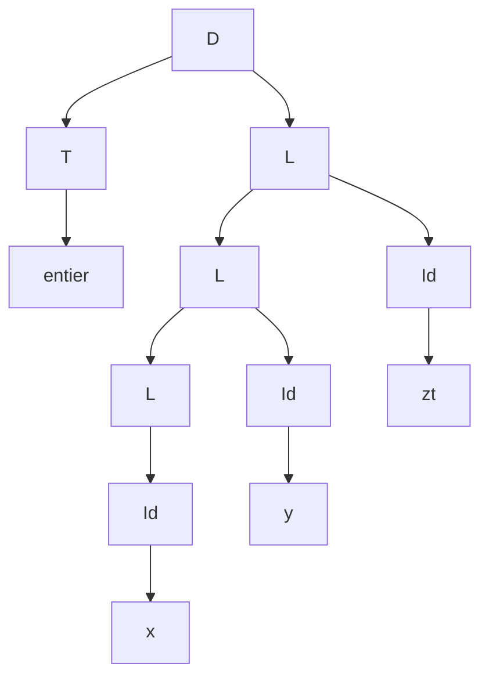

On veut assurer à chaque var qon type.

On vas associer une chaine de caratere au var Id,T et L

$\{D.T=T.t\}$                $T=\{T.t="E"\}|\{T.t= "R"\}$

$\{L.T=D.t\}$               $\{L_1.t=Id.t=L.t\}|\{Id.t=L.t\}$

## Calcul des attributs

- La grammaire est dite S-atribue si elle ne contient que des attribut shynthetiques  
  Proposition : ce calcul des attribut d'une grammaire S-attribuee se fait de feuille à la racine

- Une grammaire est L-attribuee si le calcul de chaque attribut herité d'un noeud ne depend que des attibut des noeud avant lui dans l'ordre prefixe  
  Proposition : ce calcul des valuer herite peut etre calculé en meme temps que l'on calcul un arbre de derivation si on faitune derivation gauche.

Une grammair S-attribue est aussi L-attribuée

# Heuristique pour analyse synthaxique

Rappel : pour une grammaire on peut decider si $w \in L(G)$ en temps $f(|G|).|w|^3$

2 type d'algo le reconaissant

## Top-Down :

On commence par la variable de depart S, et on essaie de trouver la sequence des regle pour genere w.

## Bottom-Up :

On part des prefixe/suffixes et on essai de trouve les regles qui permettent de les obtenir et oncontinue j'usqua obtenir la racine S.

Ex: w=aacba

$S\to aX|aaY$

$X\to aX|bY$

$Y\to cbY|a$

$S\to aaY \to aacbY\to aacba$

$S \to aX$ :

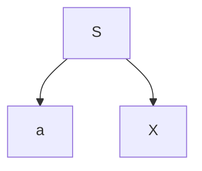

$X\to aX$ :

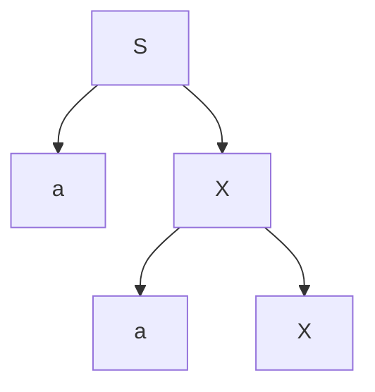

$X\to aX$ :


Probleme ! , on remonte et on teste tout les possibilite.

$X\to bY$ :

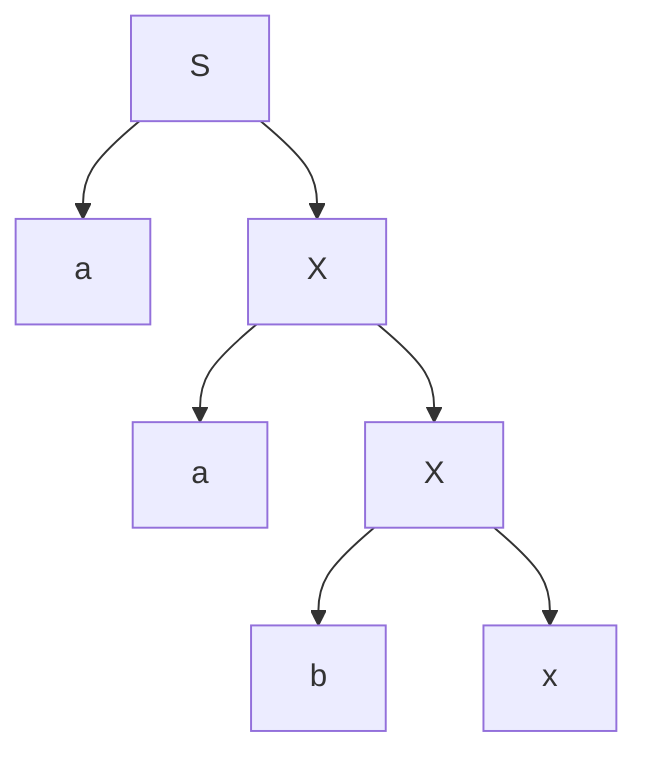

On continue jusqua trouve le bon resultat.

---

Ex : Analyse bottom-up

On part des feuille pour remonter jusqua la racine pour former le mot.

Ce genre de parser donne plus de language que les Top-down 

Ex de parser: bottom-up : LR(k)

1. Top down cavec backtracking  
   Calculer un arbre de dérivation, en suivant les règles suivantes.

   1. toujours faire une derivation et choisir dans un ordre fixe avant de commencer

   2. Lorsque l'on ne peut pas continuer, on retourne en arriere et on essaie une nouvelle regle.

Probleme :

- Cette algorithme s'execute en temps exponentiel au pire des cas.

- Si $G$ est recursive a gauche, on ne peut pas deriver. Une varriable est dite recursive gauche si $A \to^* A\alpha$. On dit que $G$ est recursive gauche si il existe une varriable recursive gauche.

**Proposition :** Pour toute grammaire $G$,il existe une grammaire $G'$ non recursive gauche avec $L(G)=L(G')$. Deplus $G'$ se calcule a partir e $G$.

**Preuve :**

Algorithme d'elimination de la recursivite gauche.   
$X$ admet une recursive gauche direct si $X\to X\alpha$ est un regle.  
Prenon $A$ recursive gauche direct : $A\to A\alpha_1|A\alpha_2|...|A\alpha_p|w_1|...|w_l$.

- On ajoute une nouvelle variable, nomons la $Z$ .

- On enleve toutes les regles de A, recursivesgauche direct de $A$ ou pas

- On ajoute les regles suivantes:

  - $A \to w_1|...|w_l$

  - $Z \to \alpha_1Z|\alpha_2Z|...|\alpha_pZ|\epsilon$
1. On numerote les variables $A_1,A_2,...,A_n$

2. execute l'algorithme suivant.

   ```
   Pour i de 1 à n Faire
       Pour j de 1 à i-1 Faire
           enlever les regles Ai-> Aj a
           ajouter les regles Ai -> ba lorsque Aj -> b est une regle
       enlever la recursivite gauche direct de Ai
   ```

Cet algorithme suppose que la grammaire n'a pas de cycles(que l'on peut enlever en transformant en FNC)

EX: 

$S \to Xa|b$

$X \to Sd|Xc|\epsilon$

$i=1$ : pas de variable plus petite que $S$ (on entre pas dans le 2nd boucle). $S$ n'est pas recursive a gauche direct.

$i=2$ : 

- on enleve la regle $X \to Sd$

- on ajoute les regles $X \to Xad| bd$

$G' = S \to Xa|b; X \to Xad|Xc|bd|\epsilon$ 

on a bien $L(G')=L(G)$

on enleve la recursivite gauche direct sur $X$ 

on ajoute $Z$

$X\to bdZ|Z$

$Z \to adZ|cZ|\epsilon$

$G''= S\to Xa|b;\ X\to bdZ|Z; \ Z\to adZ|cZ|\epsilon$ est non recursive a gauche.

Comme l'algorithme peut etre exponentiel, on essaie de deviner la prochaine regle tout en evitant de refaire laprochaine regle tout en evitant de refaire des calculs.

Comment : On peut factoriser la grammaire , ceci repousse les choix vers les feuilles.

Ex:

- $S \to$ : si $E$ alors $S$|si $E$ alors $S$ sinon $S$ | a
- $E \to c$

### Factorisation gauche

$A \to \alpha_1|...|\alpha_k$

Notons $\alpha$ le prefixe maximum commun des $\alpha_i$

Donc on a comme regles : $A \to \alpha w_1|...|\alpha w_k$ ou $\alpha_i = \alpha w_i$

La factoriastion, supposant $\alpha \neq \epsilon$:

- enlever $A \to \alpha_i; \ \forall i$

- ajouter $A \to \alpha A'; \ A' \to w_1|...|w_k$

### Top-down Predictif

- On lit quelque lettre et c'est suffisant pour decider la prochaine regle.

- Si on a besoin que de k lettre, on dit que la grammaire est dans LL(k)

ex : $*EE|+EE|a\in LL(1)$

# Résoudre certaines ambiguïtés

**Theoreme :** On ne peut pas decider si pour un language (donnée par une grammaire) admet une grammaire non ambigue.

On vas regarder 3 cas d'ambiguite:

- associativite

- priorite

- parenthesage

## Associativité

Une operation est associative = l'ordre d'execution n'est pas important

Ex: $E \to E+E|(E)|nb$

Résoudre cette ambiguite consiste a choisir 1 ordre d'execution.

Comment forcer l'associativite a gauche:

Introduire une nouvelle variable,notons la $F$ et cette variable representera la partie la plus a droite de la derivation.

$E\to E+F|F; \ \ F\to (E)|nb$

## Priorite

$E \to E+E|E*E|(E)|nb$

Regles:

- On fixe une associativite gauche pour chaque operation associative

- On force les priorités: la derivation doit toujours commencer les operation de haute priorite

Ex: $E \to E+T |T; \ \ T\to T*F|F; \ \ F\to (E)|nb$

## Parenthesage

$I \to$ : si $E$ alors $I$|si $E$ alors $I$ sinon $I$ | a
$E \to c$

Probleme: le Sinon va avec quel Si

Solution : faire un choix autoritaire

ex : 

- dernier sinon avec le 1er Si

- 1er sinon avec le 1er Si

Grammaire non ambigue:

$I \to A|B$

$A \to \text{Si c alors }A \text{ Sinon }A|a$

$B \to \text{Si c alors }I|\text{ Si c alors }A \text{ Sinon }B$

# Analyse sémantique et generation de code

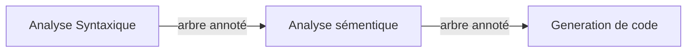

## Analyse Semantique

**Objectif :** controleque l'on ne peut pas faire avec la grammaire. On donne du sens aux constructiondu language.  
La grammaire attribuee dit permettre/ facilite ces verification sémantique.

Exemple de verification sementique:

1. verification des types:  
   x+5; x entier ?  
   x(5,6); x fonction ?,argument de type entier?

2. assignation:  
   x=7; x existe ?, x est un entier?

3. recuperer la valeur d'une variable

4. recupere l'adresse d'un fonction

## Generation de code

Codes source −−−> language machine

Instruction −−−> ensemble d'instruction machine

Comment: parcours de l'arbre de deriavation attribue (bottom-up)

Pre-requis: 

- gestion de la memoire de la machine

- connaitre le language machine

### Machine MVaP

- Utilise une pile adressable comme mémoire

- Chaque instruction prend ses argument dans la pile et peut modifier la pile

- Instruction de calcul arithmetique et de saut

#### Memoire MVaP

- La memoire est divisée en mots

- Chaque mot est adressé par un entier (0 à nb mots)

- la taille d'un mot est la taille d'un entier

- Memoire est divise en 2 blocs

  - bloc d'instruction

  - bloc memoire programme

- La taille de chaque instruction est connue avant d'execution: vpas de memoire dynamique

- mono-programme et execution sequentielle

- il y a :

  - un compteur ordinal (numero desinstruction)

  - un numero de taille de pile

  - registre speciaux pour la memoire globale (gp), memoire local(lp)

#### Execution machine MVap

On dispose de simulateur de cette machine.


Les simulateur sont ecrit en java + assembleur

Java MVap Assembleur code.mvap construit le code executable nomme code.mvap.cbap

`java CBaP -d code.mvap.cbap` avec `-d` le debug mode.

#### Quelques instruction MVaP

- READ : lecture standard et emplacement valeur

- WRITE : ecriture standard tete de pile

- Operation arithmetique : ADD,SUP,DIV,MUL  
  Prend al tete de pile et la valeur en dessous de la tete de pile et effectue l'operation arithmetique sur ces 2 operandes

- PUSHI n : empile la valuer n

- POP : depile

- JUMP n : Saut vers l'adresse n

- ...

ex: 5 \* 3 + 2 / 7

```
PUSHI 7
PUSHI 2
DIV
PUSHI 5
PUSHI 3
MUL
ADD
HALT
```

ex2: 

$E\to E_1+E_2$

$E\to E_1*E_2$

$E \to INT$

$\{E.code=E_1.code+E_2.code+ADD\}$

$\{E.code=PUSHI+INT.text\}$

4 Construction :

- expression arithmetique et booleennes

- structure de controle(Si Sinon et boucles)

- Varriables

- Fonctions

#### Expression arithmetique et booléennes :

On suit l'arbre de derivation de bas en haut (des feuilles aux racines).  
La machine MVaP n'a pas de booleens => le code MVaP des booleens utilise les operation arithmethiques

ex:  
Faux -> 0 

Vrai -> 1

et -> produit

ou −> addition(et on revient a 1 lorsque c'est sperieur a 1)

negation -> 1-valeur c

ex : $B \to B \ or\ B|B \ et\ B|Vrai|Faux$

$B \to Vrai$ {\$code="PUSH 1\n";}

$B \to Faux$ {\$code="PUSH 0\n";}

$B \to B_1 \ or\ B_2$ {\$code=\$B1.code + \$B2.code+"ADD\n" + "code pour revenir à 1";}

$B \to B_1 \ et\ B_2$ {\$code=\$B1.code + \$B2.code+"MUL\n";}

#### Variables :

On fait comme en C : chaque variable correspond à un espace mémoire: le contenue sera la valeur de la variable.

3 Question :

- comment declarer un espace memire

- commetn y acceder 

- commet gerer les type

##### Comment declarer un espace memoire :

On a 2 categorie de varraibles : 

- Les variables locales : ne sont visibles que dans un bloc. (variable dans une fonction, variable dans un bloc d'une boucles,...)

- Les variables globales: communes à toutes les parties du code correspondant , on s'interesse aux variables gobales, on verra les variable locale avec les fonctions.

##### Comment y acceder :

On a 2 instructionde MVaP. :

- PUSHG n : prend la valuer qui se trouve à l'adresse n et va l'empiler.  
  si une variable se trouve à l'adresse 100, on fait PUSHG 100 permet d'acceder à la valeur.

- STOREG n: prend la tete de pile, le stocke à l'adresse n et depile.  
  ex : PUSHI 5; STOREG 10;

ex : x=x+5

```
PUSHG 10 //suposant x est a l'adresse 10
PUSHI 5
ADD
STOREG 10
```

##### Reservation memoire variable globale

Du point de vue du compilateur, les 2 vues sont les memes et le programmes à l'adressse relative 0.

La machine dispose d'un MMU(traducteur des adresse) qui transformechaque adresse relative en adresse physique.  
Pour allouer une adresse pour une variable, le compilateur a besoin de savoir l'adresse quelle a alloué en retour. La machine MVaP ne nous la donne pas, on triche et on effectue les declaration au debut du programme et on garde une variable pour connaitre l'adresse de la prohaine variable si besoin.

Ex:

int x,y;   x->0,y->1

float z; z->2

int t; t->4 car z prend 2 mots

Pister la taille de la pile pour avoir les informations 0,1,2,4

##### Comment gerer l'allocation:

- Utiliser une operation d'empilement (PUSHI pour les entier, PUSHF pour les flottants)

- Stocker dans une table d'association, appelée table des symboles, les informations suivantes au minimum:

  - type de la variable

  - son som

  - son adresse

##### Utilisation :

utiliser la table des symboles pour faire l'analyze sémantique

ex: x=y+5 :

- verifier que x et y existent

- verifier que x et y sont des entiers.

- recuperer les adresse de x et de y dans la table des symboles pour generer le code MVaP associé

EX dans ANTLR:

```antlr4
grammar Ex-Parser;
@members {
    Hashmap <String,Integer> Tab = new Hashmap<String,Integer>();
    String code = new String(); //accumulateur pour le code MVaP
}
@header {import java.util.Hashmap;}
```

    start:
        declaration *
        instruction * EOF;
    declaration: TYPE ID "i";
    instruction returns [String Code]: //la regle instruction a un attribut
                                       //qui s'appelle code et qui est un Str
    
    
    
    int x        PUSHI 0        (x,0) dans Tb
    int y        PUSHI 0        (y,1) dans Tb
    int z        PUSHI 0        (z,2) dans Tb
    z=x+y        PUSHG 0
                 PUSHG 1
                 ADD
                 STOREG 2
    x=z-x        PUSH 2
                 PUSH 0
                 SUB
                 STOREG 0

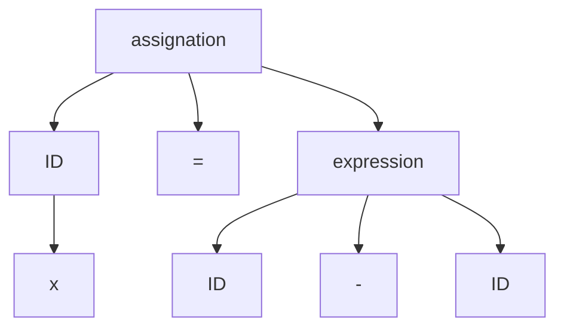

#### Structure de Controle Pour modifier le flux d'execution d'un programme.

Pour modifier le flux d'execution d'un programme 

- Si ... Sinon

- Boucles 

- Appels de fonctions

Ceci est fait avec les instruction de Saut.

On a 2 categorie:

- Saut conditionel

- Saut non conditionelle(appel de fonction, retour de fonction,...)

Les 2 se font avec un systeme d'etiquetage et des instruction de MVaP.

On etiquette les bouts de code ou on veut faire un saut.

LABEL n // n entier

// Code MVaP

Pour la machine : le code qui va suivre, on lui associe une adresse calculée à l'assemblage.

On a 2 instruction:

- JUMP n : saut non conditionelle à l'adresse associe à l'etiquette n.

- JUMPF n: Saut conditionelle, Si la tete de pile est Vraie, On execute ce qui se trouve apres le JUMPF Sinon on fait un saut vers l'adresse n.  
  On l'utilise pour les Si...Sinon et les boucles

Ex: 

    int x
    si 5==6 alors
        x=5
    sinon
        x=7

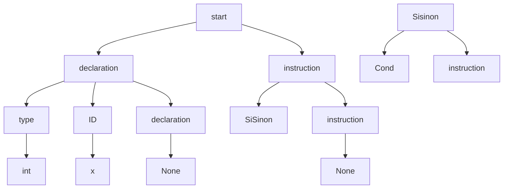

#completer

Le resultat de la compilation est  la valeurde code à start= concatenation du code des declaration et du code des instruction.

```
PUSHI 5
PUSHI 6
EQUAL
JUMPF 0
PSUHI 5
STOREG 0
JUMP 1
LABEL 0
PUSHI 7
STOREG 0
JUMP 1
LABEL 1
HALT 
```

#### Fonctions

une fonction =bout d'un programme qui a un nom et des entrées.

Pour utiliser ce bout de programme:

- on utilise le nom

- on donne des valuer aux entrées.

Ceci pose 2 probleme:

- Comment donner des entrées

- Comment retourner la valeur calculée(et revenir au programme appelant)

L'instruction Label nous permet d'associer une fonction à une etiquette

La machine va proposer des instruction speciales pour appeler 1 fonction appelante.  
A partir de ca, le compilateur decide de la politique d'appel de fonction. La machine utilise la pile d'execution.

Comment fait la machinne :

- elle stocke la memoire de la fonction appelante (comme la mèmoire est une pile, c'est juste stocker la taille de la pile).

- elle stocke l'instruction (son adresse) ou elle doit retourner

- elle fixe une adresse de base (considere comme l'adresse 0) de la fonction => on peut avoir des varriables locales

La machine propose :

- CALL : pour appeler une fonction  
  ex: CALL n : n = etiquette de la focntion appelée

- RETURN : derniere instruction MVaP de chaque fonction qui permet de retourner à la fonction appelante.

Il reste à definir laconvention entre fonction appelante et fonction appelée pour recuperer les valeur des arguments et la valeur de retour:

- la fonction apelante allou de la memoire pour la valuer de retour et donne dans la pile les argument (ordre=orde de la fonction appelée)

- la fonction pourra recuperer ces valuer et/ou y stocker des valuer en utilisant des instruction de variable locales

La machine vas proposer des instruction speciales  pour appeler une fonction et retourner vers la fonction appelante. A partir de ca, le compilateur decide de la politique d'appel de la fonction. La machine utilise la pile d'execution.

Pour resumer :

valeur de sp et le numero de l'instruction sont stockées lorsque l'on fait CALL 5.(5 etiquette de f).  
Avant le CALL, le compilateur doit reserve un espace pour la valuer de retour et stocker les 2 argument.

ex: 

```
PUSHI 0  //espace valeur de retour
PUSHI 5  //empilement argument 1
PUSHI 6  //empilement argument 2
CALL 5
LABEL 5:
    PUSHL -1
    PUSHL -2
    STOREL -3
    RETURN
```

ici on a retourne la valeur du premier argument

PUSHL n : si l'adresse de depart de la fonction f est stockée dans le registre fp, alors PUSHL n empile la valeur de l'adresse fp+n

STOREL n : ecrit dans fp+n la tete de pile

Comme la fonction appelante a empilé, les argument pour la fonction appelée, les premiere instruction apres un CALL doivent etre le depilement de ces argument (pour acceder a la valuer de retour)

dans cet exemple:

    PUSHI 0
    PUSHI 5
    PUSHI 6
    CALL 5
    POP
    POP
