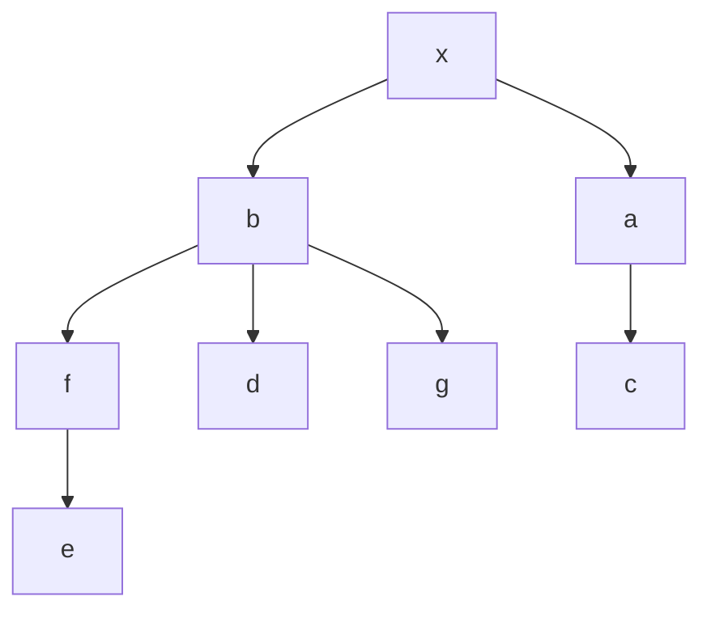

# Q1

Montrons que $cc(G+e) \leq cc(G)+1$.

Soit $e=\{x,y\}$ n'est pas une arrete deconnectente, alors le nombre de composante connexe reste le meme.

Sinon si $e=\{x,y\}$ est une arrete deconnectente, si $x,y \in C_i$ de $G$, $C_i$ partitioné en $C_i^x$ et $C_i^y$ car $x$et $y$ séparait la paire $a,b;\space a\in C_i^x \ et \ b\in C_i^y$. 

# Q2

Montrons par l'absurde qu' un graphe connexe pair ne possede pas d'arrete deconnectante.

$G$ pair et il existe $e=\{x,y\}$ deconectente.

Dans $G-e$:

- $\delta_{G-e}(x)$ est impair
- $\delta_{G-e}(y)$ est impair

$\delta_{G}(C_x)$ est impair et c'est le seul sommet de degres impair : Contradiction(ex2 TD1)

Pair $\implies$ decomposition en cycle $\implies$ au plus $\delta(v)/2$ cycle (car 1 entre associe a une sortie)

comme cycle alors si on supprime le noeud , on supprime 1 chemin de $x$ à $y$ mais il y en minimum 1 restant. Donc $G$ est connexe.

Donc il y a au plus $\delta(v)/2$ composante connexe.

# Q3

$G=(V,E)$ pair, $\exists \mathcal{C}=\{C_1,C_2,...,C_k\}$ une decomposition en cycle $\mathcal{C}$.

chaque sommet $v$ appartient à $\delta_g(v)/2 cycles.$

# Q4

contre exemple

# Q6

$\{b,a\} \to \{a,f,d,g\} \to \{f,d,g,c\} \to \{d,g,c,e\} \to\{\}$ 

resultat : [x,b,a,f,d,g,c,e]

# Q9

**Theoreme :** G est bipartie ssi chaque niveau (l[i]) induit un stable.

$\implies$ par contrapose:

sil il existe un niveau $j$ qui contient un arrete $e=\{x,y\}$ soit $x$ et $y$ ont le meme parent $v$.  
$G$ contient un cycle de taille 3 (donc pas bipartie).  
Sinon $x$ a un parent $w$ et $y$ a un parent $z$.  
Si on considere le chemin $P_x$ de $w$ à $s$ et le chemin $P_y$ de $z$ à $s$.  
Soit $t$ le plus petit ancetre commun de $w$ et $z$. La longeur de $t$ à $x$ et la longeur de $t$ à $y$ sont identique. Si on considere $P_x , P_y$ on a un chemin de $x$ à $y$ de longeur paire. En ajoutant $\{x,y\}$ on ferme un cycle de longeur imapaire.  
Donc $G$ n'est pas bipartie.

$\impliedby :$

On  constuit la partie A, tous les sommets qui sont sur un niveau pair.  
On construit la partie B, tous les sommet qui sont que un niveau impair.  
On doit prouver que $G[A]$ est un stable et $G[B]$ est un stable.

spdg pour A.

soit $x,y$ deux sommet de A:

- on a $l[x]=l[y]$, comme ils sont au meme niveau: pas d'arrete.

- on a $l[x]<l[y]$, comme $l[x] \equiv 0[2]$ et $l[y] \equiv 0[2]$, on a $|l[x] - l[y]|\geq 2$.  
  Par l'exo 8 pas d'arette.

