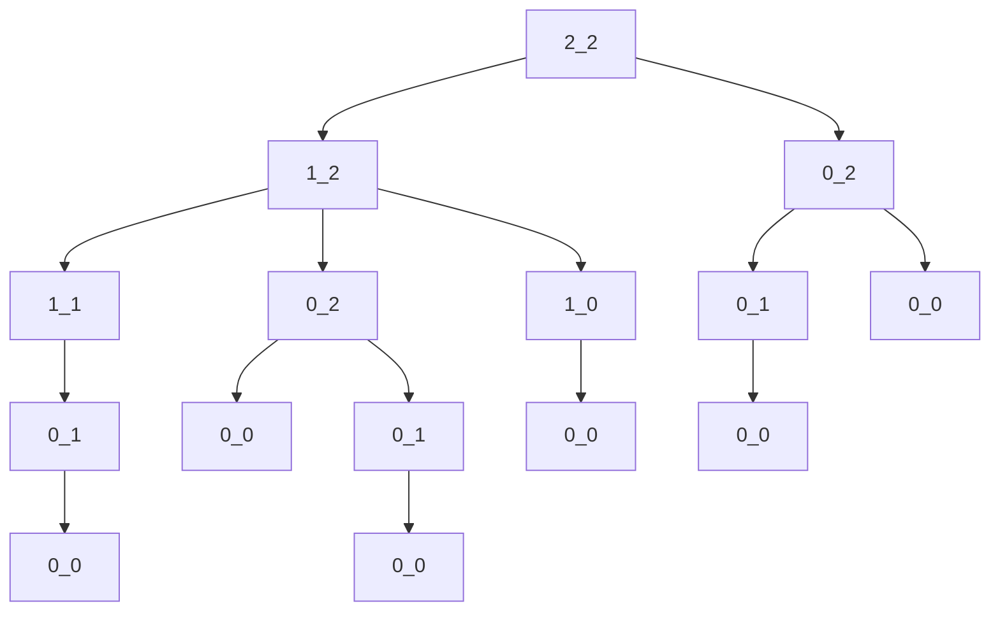

# Jeux a 2 joueurs

## Contexte et definitions

**Un jeu :**

- N joueurs (N=2)

- Un ensemble de  strategie pour chaque joueurs

- Une issue du jeu = definition de ce qur chaque joueurs obtient à la fin du jeu

Remarque : Les strategie peuvent etre tres complique ou tres simples. On peut en avoir beaucoup mais en nobre fini.

Pour 2 joueurs I et II on aura n strategie pour I : i= 1,...,n  et m strategie pour II, j =1,...,m. L'issue du jeu est donne par une valeur qui comprend au choix de la strategie i pour I et j pour II.

2 Type de Jeu : 

- Simultanée

- Sequentiels

## Representation du jeu Simultané :Forme normal du Jeu

### Jeu a somme nulle

Les 2 joueurs choisissent une stategie en meme temps , i pour I et j pour II: la valeur $a_{ij}$ et la valeur gagnée ou perdue par I et son opposé est la valeur perdu ou gagne par II -> c'est le cas d' un jeu à somme nulle.

La representation de ce jeu est une matrice du jeu à n ligne et m colones.(I gagne $a_{ij}$ et II le perd)

#### Exemple : Pierre Feuille Ciseaux

- 2 joueurs I et II

- 3 strategies P,F,C

- Issue 

  - +1 gain

  - -1 perte

  - 0 neutre

|       | P   | F   | C   |
| ----- | --- | --- | --- |
| **P** | 0   | -1  | +1  |
| **F** | +1  | 0   | -1  |
| **C** | -1  | +1  | 0   |

### Jeu a somme constante :

$a'_{ij}$ est le gain ou la perte de II et $a_{ij}$ le gain ou la perte de I, alors $a_{ij} + a'_{ij}=C$ est une constante.

#### Exemple :

2 entreprise introduisent le meme produit sur le marche et choisissent sur une periode de 3 mois, le mois ou le produit est proposé.

Le jeu est simultané : 

- strategie : mois

- Issue : la part de marché

|       | 1   | 2   | 3   |
| ----- | --- | --- | --- |
| **1** | 0,5 | 0,6 | 0,8 |
| **2** | 0,4 | 0,5 | 0,9 |
| **3** | 0,2 | 0,4 | 0,5 |

Si I choisit le mois 2 et II choisit le mois 3 => I gagne 0,9 et II gagne 0,1 . La constante est égale à 1.

### Jeu sequentieles : forme extensive

Les joueurs jouent leu strategies chacun à son tour.

La representation se fait sur un arbre appelé l'arbre de Kuhn.

### Exemple Jeu de Nim 2*2:

4 piece de monnaie sont disposée sur 2 piles et 2 faces.

Le joueur I choisit une pile est decide d'enlever 1 ou 2 piece de cette pile. pUis le joueur II choisit à son tour une pile avec au moins 1 piece et decide du nombre de piece a retier. Puis I continue avec ca strategie.  
Lorsque les 2 piles sont vides, le jeu s'arrete. Le perdant est celui qui a enleve la deuxieme piece.

Sur l'arbre 1 chemin de 2_2 à 0_0 respresente une suite de strategie alterne entre I et II

Strategie de I :

a) jouer 1_2 et si II 0_2 alors 0_1

b) jouer 1_2 et si II 0_2 alors 0_0

c) jouer 0_2

farie apreil pour II

#Acompleter

---

Jeu a somme nulle à 2 joueurs:

Cas de jeux simultannée representé par une matrice de jeu :

- I joueuer en ligne avec son ensemble de strategie {1,...,n}

- II joueur en colone avec son ensemble de strategie {1,...,n}

La matrice $A=(a_{ij});i,j\in [1,n]$ 
