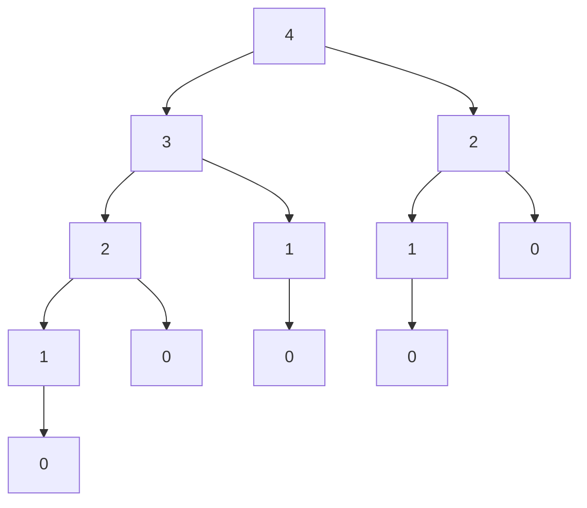

# Ex1

## Q1:

| A/B   | 1   | 2   | 3   | 4   | 5   |
| ----- | --- | --- | --- | --- | --- |
| **1** | 0   | +2  | -1  | -1  | -1  |
| **2** | -2  | 0   | +2  | -1  | -1  |
| **3** | +1  | -2  | 0   | +2  | -1  |
| **4** | +1  | +1  | -2  | 0   | +2  |
| **5** | +1  | +1  | +1  | -2  | 0   |

## Q2:

$v^+=\min\{1,2,2,2,2\}=1$ colones

$v^-=\max\{-1,-2,-2,-2,-2\}=-1$ lignes

$v^-<v⁺$ le point selle n'existe pas

# Ex2

## Q1:

lever 1 ou 2 doigts, deviner a ou 2 doigt pour l'autre

## Q2:

| A/B   | (1,1) | (1,2) | (2,1) | (2,2) |
| ----- | ----- | ----- | ----- | ----- |
| (1,1) | 0     | +2    | -3    | 0     |
| (1,2) | -2    | 0     | 0     | +3    |
| (2,1) | 3     | 0     | 0     | -4    |
| (2,2) | 0     | -3    | +4    | 0     |

$v^+=\min\{3,+2,+4,+3\}=2$

$v^-=\max\{-3,-2,-4,-3\}=-2$

# Ex3

## Q1:

**A:**

$v^+=\min\{1,2\} si \ x\leq2$

$v^+=\min\{1,x\} si \ x>2$

$v^-=\max\{1,0\} si \ x>0$

$v^-=\max\{1,x\} si \ x\leq0$

3 cas :

- $x \in ]0,2]$:

  - $v^+=1$

  - $v^-=1$

  - donc $v=1$

- $x \in ]-\inf,0]$:

  - $v^+=1$

  - $v^-=1$

  - donc $v=1$

- $x \in [2,+\inf[$:

  - $v^+=1$

  - $v^-=1$

  - donc $v=1$

dans tou les cas $v=1$

**B:**

la meme chose car B est une rotation de A , et les ligne et les colones contient la meme chose donc ,$v^+ et \ v^-$ seront les meme.

# Ex4:

## Q1:

$v^+(A+C)=a_{ij}+c=v^+(A)+c$

## Q2:

Translate lineaire

## Q3:

idem

# Ex5:

II admet une strategie gagnante contrairement a I, il est donc preferable d'etre el II joueur.

$v^-=-1$

$v^+=-1$
